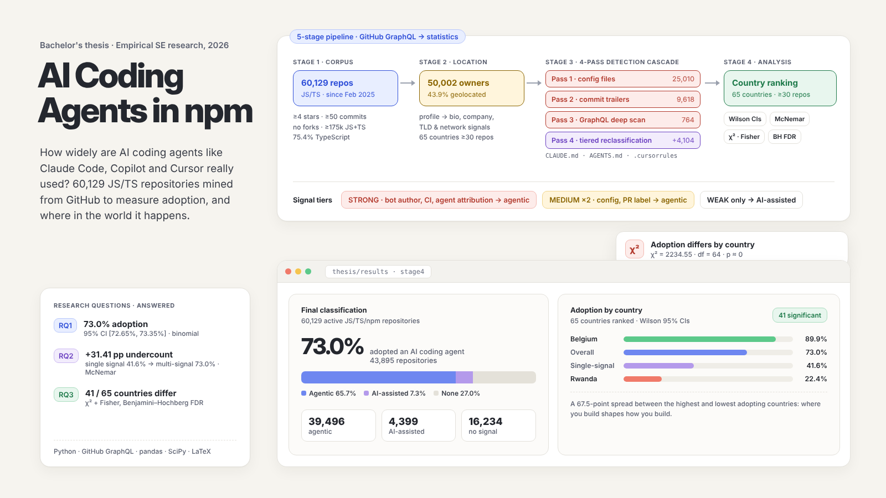
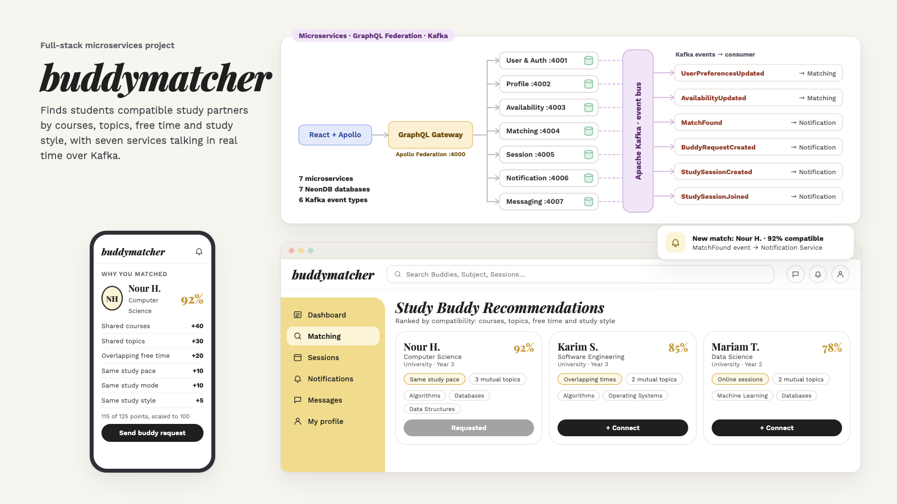
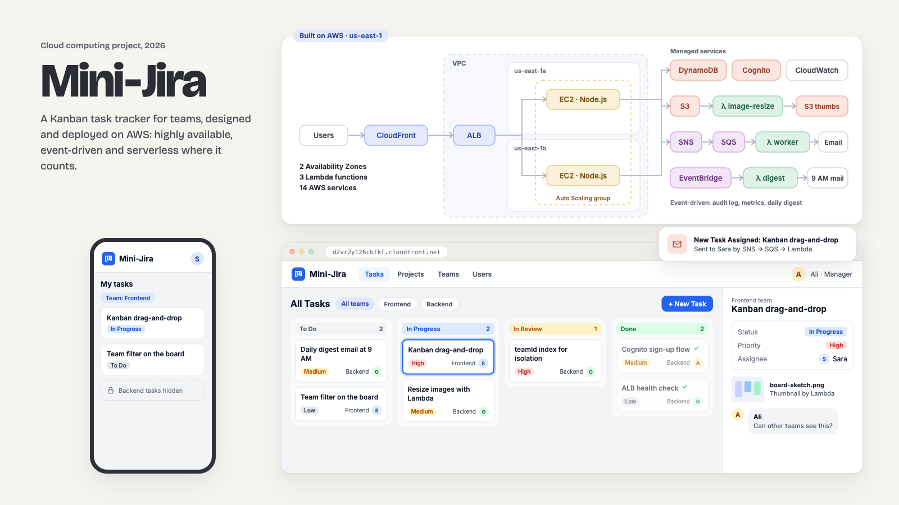
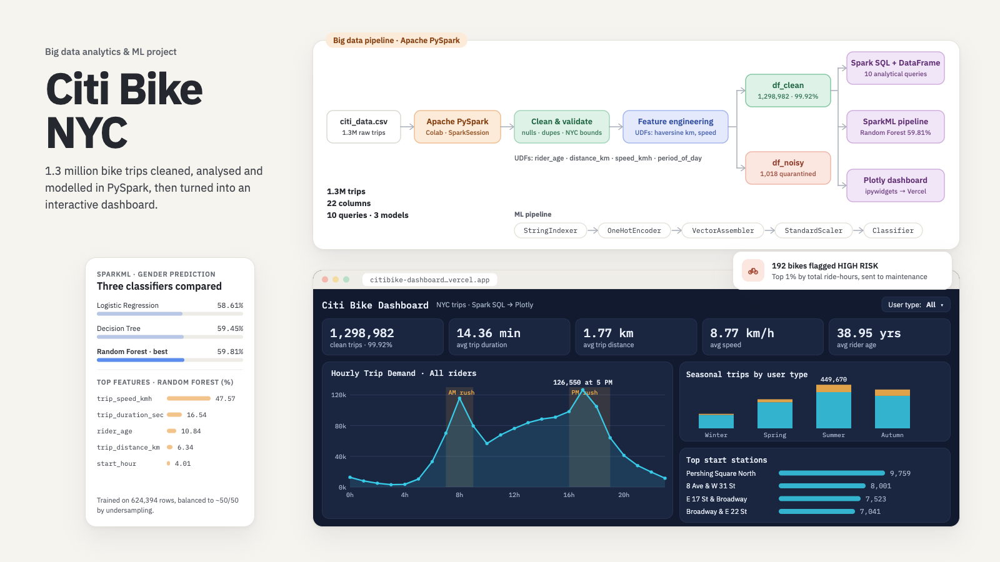
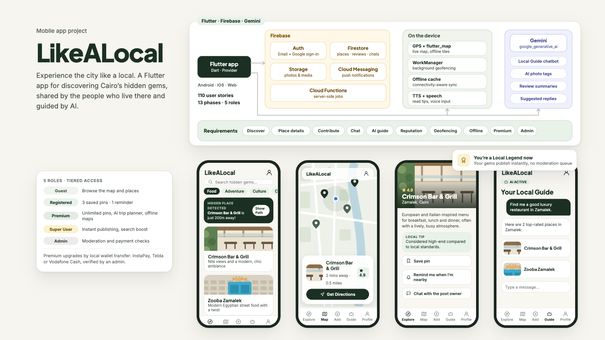
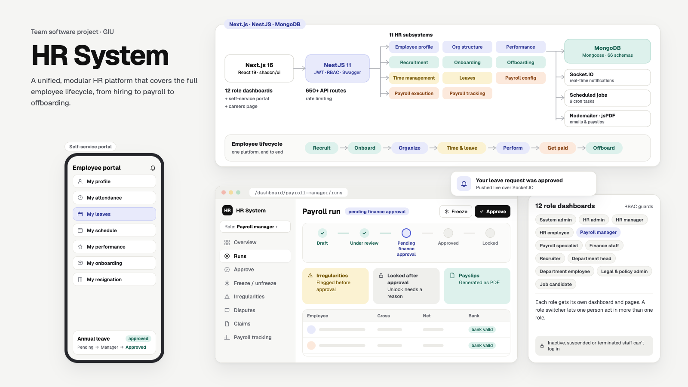
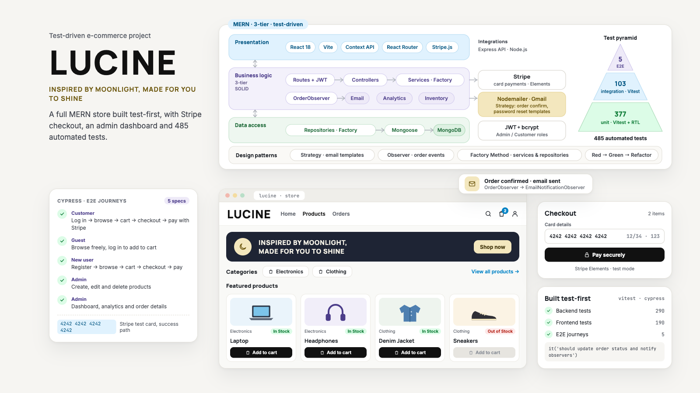
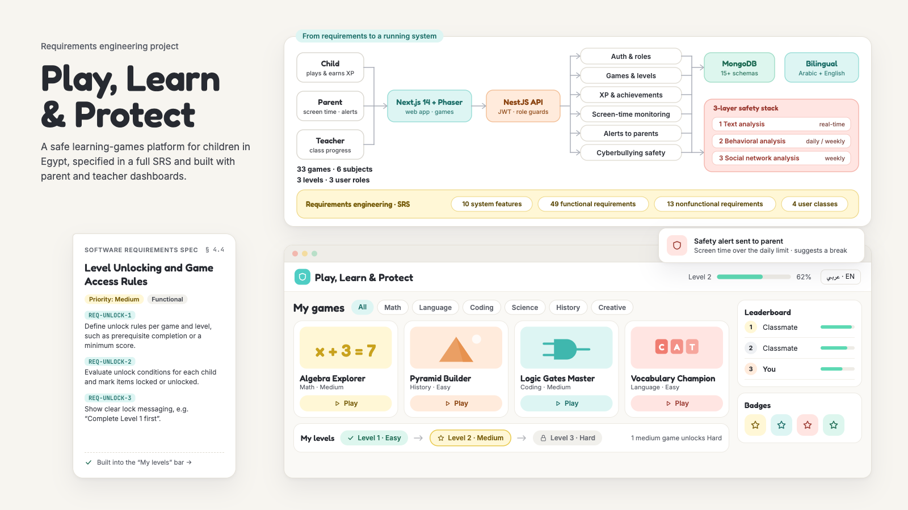
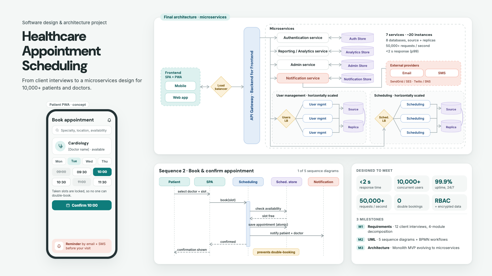

<!-- ───────────────────────────── HERO ───────────────────────────── -->

  

  
  
  
  

  

 

## 👋 About me

I'm **Manuel**, a Software Engineering student at the **German International University (GIU)** in Cairo, minoring in **Data Science & AI** and graduating in **2027**. Over the past year I've worked at **PwC**, **Eastman Kodak** and **Accord Business Group**, shipping cloud-deployed AI tools and full-stack apps to production. I like work that pairs solid engineering with research, from distributed systems to AI-powered agents.

- 🔭 Building **AI agentic tools** at PwC that turn business requirement documents into HTML prototypes in about 15 minutes
- 🎓 Writing my **B.Sc. thesis** on how widely AI coding agents are adopted across the npm ecosystem
- 🧱 Led a **21-engineer** team that shipped a 7-subsystem HR platform to production
- 🌍 Based in **Cairo, Egypt** and open to collaborating on ambitious builds

 

## 💼 Experience

<table>
  <tr>
    <td width="28%" valign="top"><b>PwC ETIC</b> Managed Services & AI Intern 📍 Cairo · Jul 2026 – Present </td>
    <td valign="top">
      • Built <b>3 AI agentic tools</b> turning BRDs into HTML prototypes in 15 min; co-designed AI training for 40–60 staff 
      • Deployed Azure Document Intelligence models, Function Apps and AI configs across Dev, Staging and Prod for 2 tax apps 
      • Resolved L1 incidents across <b>25+ enterprise apps</b> via ServiceNow, Jira and Azure DevOps
    </td>
  </tr>
  <tr>
    <td valign="top"><b>Project Management Institute</b> PM Course Pilot Volunteer 📍 Cairo · Sep – Oct 2025</td>
    <td valign="top">
      • Evaluated a 4-hour Agile project management eLearning course; gave <b>20+ improvement recommendations</b> 
      • Reviewed and refined 95% of course content for clarity, accuracy and Agile best practice
    </td>
  </tr>
  <tr>
    <td valign="top"><b>Accord Business Group</b> Software Engineer Intern 📍 Cairo · Aug – Sep 2025</td>
    <td valign="top">
      • Worked with a fraud analysis team on the end-to-end banking fraud detection lifecycle 
      • Analysed <b>100+ banking transactions</b> and fraud alerts with SAS FM, VA, VI and SQL
    </td>
  </tr>
  <tr>
    <td valign="top"><b>Eastman Kodak Company</b> Software Engineer Intern 📍 Cairo · May – Jul 2025</td>
    <td valign="top">
      • Built a full-stack app that digitised in-store queue management and customer records 
      • Turned <b>200+ daily paper entries</b> into structured records, cutting wait times by an estimated <b>20%</b>
    </td>
  </tr>
</table>

 

## 🚀 Featured projects

<!-- Flagship -->

### 🎓 [B.Sc. Thesis: AI Coding Agent Adoption in npm](https://github.com/kevorkian-mano/thesis-coding-agent-adoption)
A 5-stage research pipeline with a **multi-pass detection cascade** that classified **60,129 GitHub repositories** for AI coding agent use (Claude Code, Copilot, Cursor, Codex and more). It found **73.0% adoption**, showed single-signal detection **undercounts by 31 points**, and produced a **65-country ranking** backed by Wilson CIs, McNemar's and chi-squared tests.

<code>Python</code> <code>GitHub GraphQL</code> <code>pandas</code> <code>SciPy</code> <code>LaTeX</code>

 

<table>
  <tr>
    <td width="50%" valign="top">
      
      <h3><a href="https://github.com/kevorkian-mano/buddymatcher-microservices">🤝 Real-Time Study Buddy Matcher</a></h3>
      Led a team of 5 building <b>7 microservices</b> behind a GraphQL federation gateway, talking over <b>6 Kafka event streams</b>, with a 7-factor compatibility algorithm for real-time matches.
        
      <code>React</code> <code>Node.js</code> <code>GraphQL</code> <code>Kafka</code> <code>PostgreSQL</code>
    </td>
    <td width="50%" valign="top">
      
      <h3><a href="https://github.com/kevorkian-mano/aws-mini-jira">☁️ Mini-Jira on AWS</a></h3>
      A Kanban platform deployed across <b>2 availability zones</b> with EC2, ALB and CloudFront, plus <b>3 event-driven Lambda workflows</b> via SNS, SQS and EventBridge. 14 AWS services in total.
        
      <code>AWS</code> <code>React</code> <code>Node.js</code> <code>DynamoDB</code> <code>Lambda</code>
    </td>
  </tr>
  <tr>
    <td width="50%" valign="top">
      
      <h3><a href="https://github.com/kevorkian-mano/Citi-Bike-NYC">🚲 Citi Bike NYC Analytics & ML</a></h3>
      Cleaned <b>1.3M trips</b> to a 99.92% clean-data rate, ran 10 Spark SQL queries on demand patterns, compared 3 SparkML models and shipped an interactive dashboard.
        
      <code>PySpark</code> <code>Spark SQL</code> <code>SparkML</code> <code>Plotly</code>
    </td>
    <td width="50%" valign="top">
      
      <h3><a href="https://github.com/kevorkian-mano/likealocal-mobile-app">📍 LikeALocal</a></h3>
      A Flutter app for discovering Cairo's hidden gems through an interactive map and community picks, with <b>5 role tiers</b>, an AI local guide, P2P chat and offline maps.
        
      <code>Flutter</code> <code>Dart</code> <code>Firebase</code> <code>Gemini</code>
    </td>
  </tr>
  <tr>
    <td width="50%" valign="top">
      
      <h3><a href="https://github.com/GIU-Software-Project-I">🏢 HR System</a></h3>
      Led a <b>21-member team</b> delivering a 7-subsystem HR platform to production, ranked in the <b>top 5 projects</b>. Unified everything into one NestJS / Next.js codebase with 75+ REST endpoints.
        
      <code>Next.js</code> <code>NestJS</code> <code>MongoDB</code> <code>Socket.IO</code>
    </td>
    <td width="50%" valign="top">
      
      <h3><a href="https://github.com/kevorkian-mano/lucine-ecommerce_testdriven">🛍️ LUCINE E-Commerce</a></h3>
      A test-driven MERN store with JWT auth, Stripe checkout, a stock-validated cart and admin dashboard. Layered 3-tier architecture with SOLID design and <b>485 automated tests</b>.
        
      <code>React</code> <code>Node.js</code> <code>MongoDB</code> <code>Stripe</code> <code>Vitest</code>
    </td>
  </tr>
  <tr>
    <td width="50%" valign="top">
      
      <h3><a href="https://github.com/kevorkian-mano/play-Learn-requirements-engineering">🎮 Play, Learn & Protect</a></h3>
      A safe gamified learning platform for Egyptian children aged 3–12: <b>33 games across 6 subjects</b>, specified in a full SRS with online-safety monitoring and parental controls.
        
      <code>Next.js</code> <code>NestJS</code> <code>MongoDB</code> <code>Phaser</code>
    </td>
    <td width="50%" valign="top">
      
      <h3><a href="https://github.com/kevorkian-mano/Healthcare_Appointment_Scheduling_System">🏥 Healthcare Scheduling System</a></h3>
      From <b>12 client interviews</b> to a 7-service microservices architecture built for <b>10,000+ concurrent users</b> and sub-2s responses, documented with UML sequence diagrams.
        
      <code>System Design</code> <code>Microservices</code> <code>UML</code>
    </td>
  </tr>
</table>

 

## 🧰 Tech stack

<table>
  <tr>
    <td width="22%"><b>Languages</b></td>
    <td></td>
  </tr>
  <tr>
    <td><b>Web & backend</b></td>
    <td></td>
  </tr>
  <tr>
    <td><b>Data stores</b></td>
    <td></td>
  </tr>
  <tr>
    <td><b>Cloud & DevOps</b></td>
    <td></td>
  </tr>
  <tr>
    <td><b>Data & ML</b></td>
    <td> &nbsp; <code>Apache Spark</code> <code>Pandas</code> <code>NumPy</code> <code>Power BI</code></td>
  </tr>
  <tr>
    <td><b>AI & automation</b></td>
    <td><code>Azure OpenAI</code> <code>LangGraph</code> <code>MCP</code> <code>A2A</code> <code>RAG</code> <code>n8n</code> <code>Copilot Studio</code> <code>Power Platform</code></td>
  </tr>
  <tr>
    <td><b>Tools & practice</b></td>
    <td> &nbsp; <code>Jira</code> <code>Azure DevOps</code> <code>ServiceNow</code> <code>Agile / Scrum</code> <code>UML</code></td>
  </tr>
</table>

 

## 🏆 Certifications & awards

| | Achievement | Issuer | Year |
|:-:|---|---|:-:|
| 🎖️ | [**Apache Kafka Fundamentals**](https://certificates.confluent.io/ac700098-4e77-4748-8e2d-7754e1e1631d) | Confluent | 2026 |
| ☁️ | [**AWS Academy Graduate: Cloud Foundations**](https://www.credly.com/badges/123b3967-1b0d-4ab9-a2cc-38d7078a3fe2/public_url) | AWS Academy | 2026 |
| 🇩🇪 | [**DAAD Scholarship Recipient**](https://drive.google.com/file/d/1ir1m7NR7aHjLuTo0yNrfQyzGijuoDPG3/view?usp=drive_link) | German International University | |

 

## 🎓 Education

**German International University**: B.Sc. in Software Engineering, minor in Data Science & AI 
New Administrative Capital, Cairo · expected June 2027 · GPA 1.16 (German scale, 1.0 is best)

 

## 📊 GitHub at a glance

  
  

  

 

  Built with care in Cairo · <a href="https://kevorkian-mano.github.io/portfolio-personal/">see the full portfolio →</a>

