<!-- ───────────────────────────── HERO ───────────────────────────── -->

  <a href="https://kevorkian-mano.github.io/portfolio-personal/">
    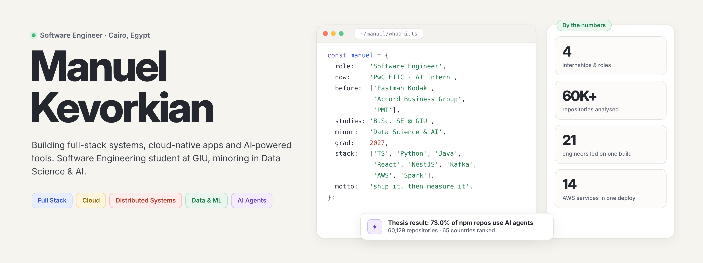
  </a>

  
  
  
  

  

 

## 🧰 Tech stack

**Languages** 
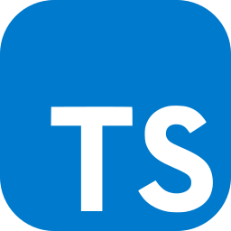 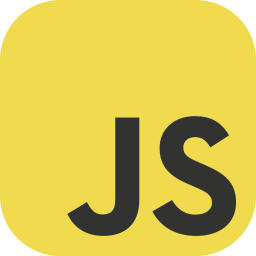 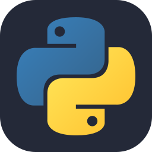 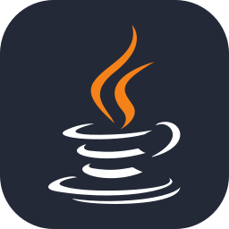 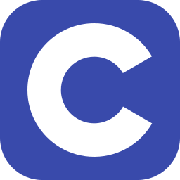 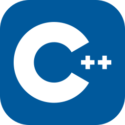 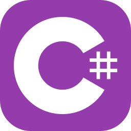 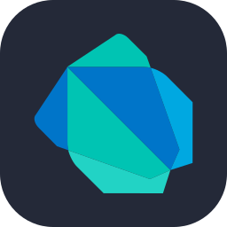

**Web & backend** 
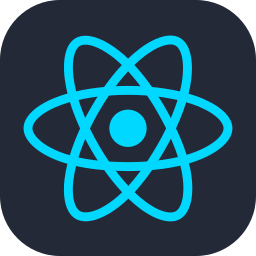 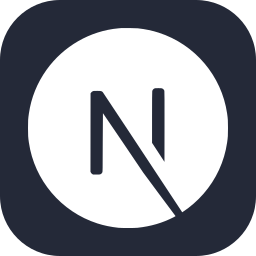 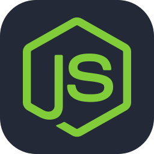 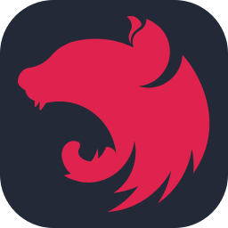 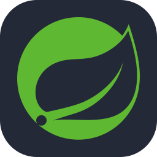 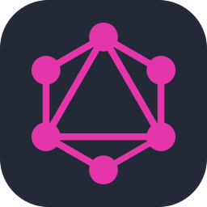 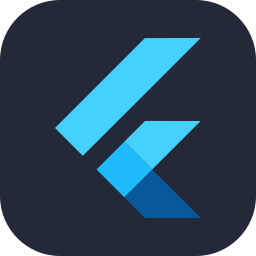  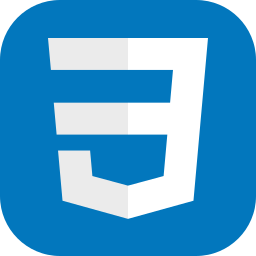 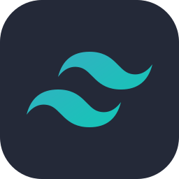 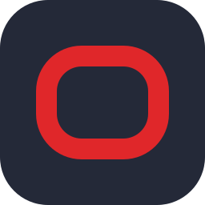

**Databases & ORM** 
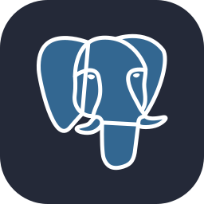 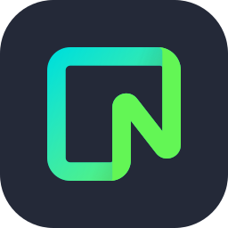 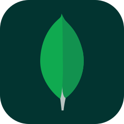 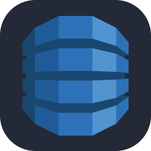 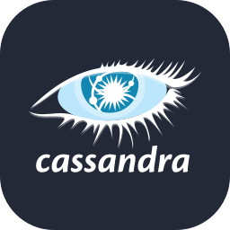 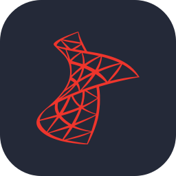 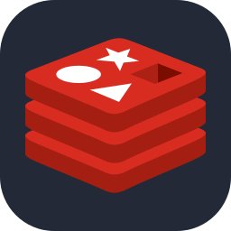 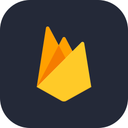 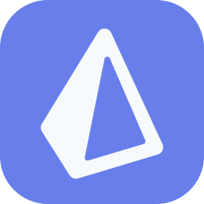

**Cloud & DevOps** 
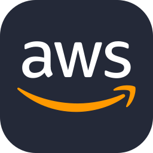 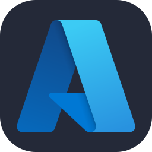 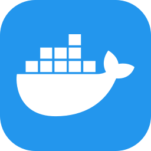 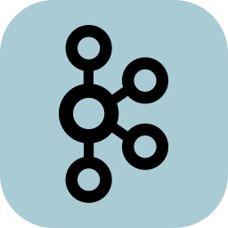 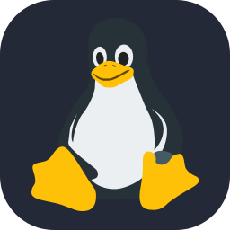 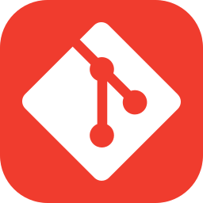 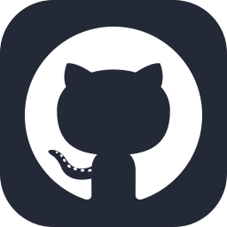 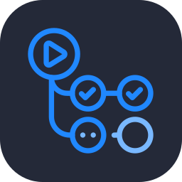

**Data & ML** 
 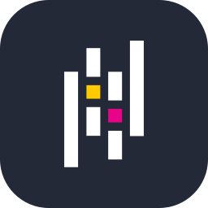 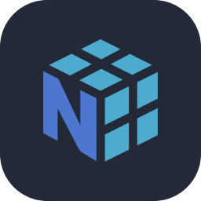 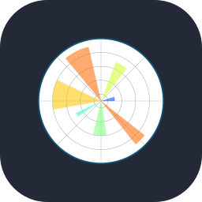 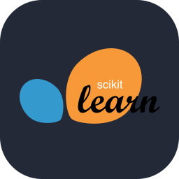 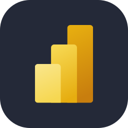 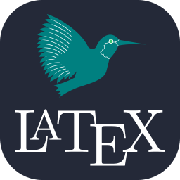

**AI & automation** 
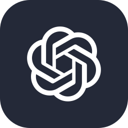 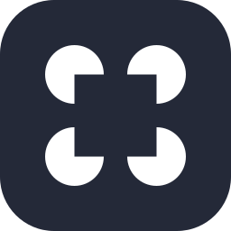 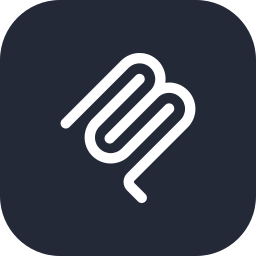 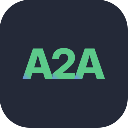 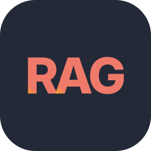 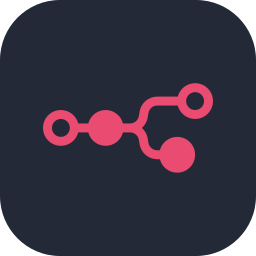 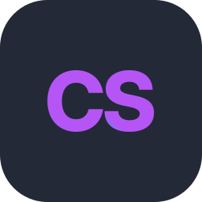 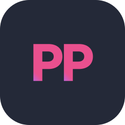

**Tools & practices** 
       

 

  Built with care in Cairo · <a href="https://kevorkian-mano.github.io/portfolio-personal/">see the full portfolio →</a>

